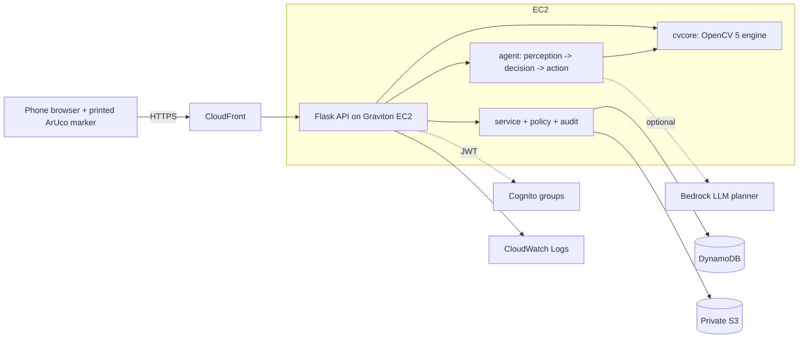

# Architecture

Diagram: `docs/architecture.svg` (open in a browser; export to PNG for Devpost if needed).

## Why this shape
* **OpenCV needs native libraries and CPU time per photo**, so the engine runs in a container on a Graviton instance (cheap arm64, `t4g.small`). A Lambda container image is a valid alternative; the code has no instance-specific state beyond the store and blob backends.
* **One origin, HTTPS.** CloudFront fronts the instance; the bucket is never public (photos are served only through the API after a policy check). This replaces serving the front end from a raw public S3 URL.
* **Two backends per concern** (SQLite/DynamoDB, local/S3, demo/Cognito) so the whole product runs on a laptop for review and on AWS for production with the same code.

## Request flow (one photo)
1. Browser uploads a JPEG (max 12 MB). The server re-encodes it (EXIF and GPS dropped) and caps its size.
2. `detect_marker` finds the ArUco marker for this case's id. The homography maps the marker's four corners to a 50 mm square on a metric canvas (6 px per mm, 240 mm window).
3. **Quality gates** run before any measurement: resolution, tilt, sharpness, coverage, glare, exposure, contrast. Each gate has a numeric value, a threshold and a human advice string.
4. The planner picks the next action. A blocked gate can only lead to `reshoot` (with the advice text). Otherwise `measure`.
5. Segmentation: black-hat with a 10 mm closing kernel, robust (median/MAD) threshold, connected components filtered by skeleton length and elongation, half-maximum refinement, width = 2 x distance transform on the skeleton, blur correction fitted on calibration seeds.
6. If a previous visit exists, both masks are in the same marker frame and are compared directly (width delta, new crack length, significance against the error bars).
7. Decision: accept, or draft a review request (severity priority/urgent, or growth beyond the error bar). Nothing is sent to anyone.
8. The visit, the full trace and the policy decision land in the case audit log.

## Data model (document store)
`case`: id, site, marker_id, lat/lon, status, severity, priority_score, simulated flag, visits[], review, authorisation, repair_evidence_ok, dispute, duplicate_reports[], audit[].
`visit`: kind, status, guidance, quality gates, measurement, comparison, repair check, trace[], blob keys (photo, overlay, mask).
`visitor`: hashed cookie id. Counters: unique_visitors, page_views, visits_processed.
DynamoDB layout: partition key `k` (kind), sort key `i` (id), attribute `doc` (JSON string).

## Case state machine
`AWAITING_PHOTO -> NEEDS_RESHOOT | MEASURED | REVIEW_REQUESTED -> AUTHORISED -> (after-repair evidence) -> CLOSED -> DISPUTED -> (uphold: REVIEW_REQUESTED | reject: CLOSED)`.
`CLOSE` is forbidden unless `has_authorisation` and `repair_evidence_ok` both hold (rule F-CLOSE-NEEDS-EVIDENCE). The reporter can never authorise or close their own report.
